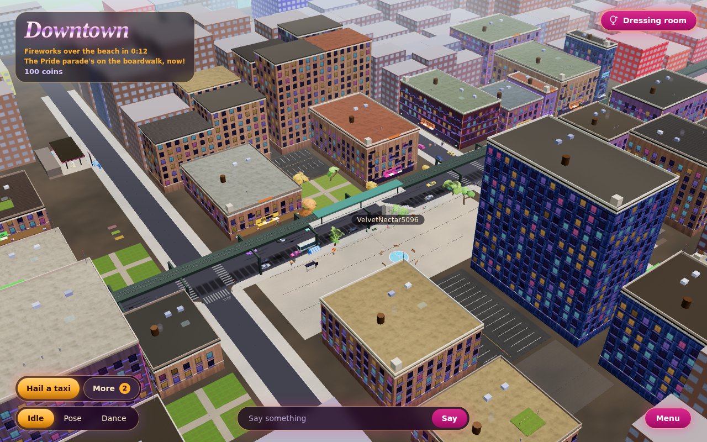
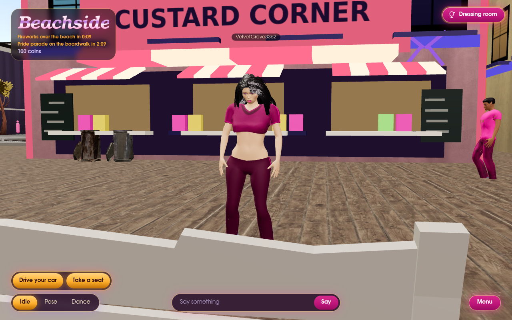
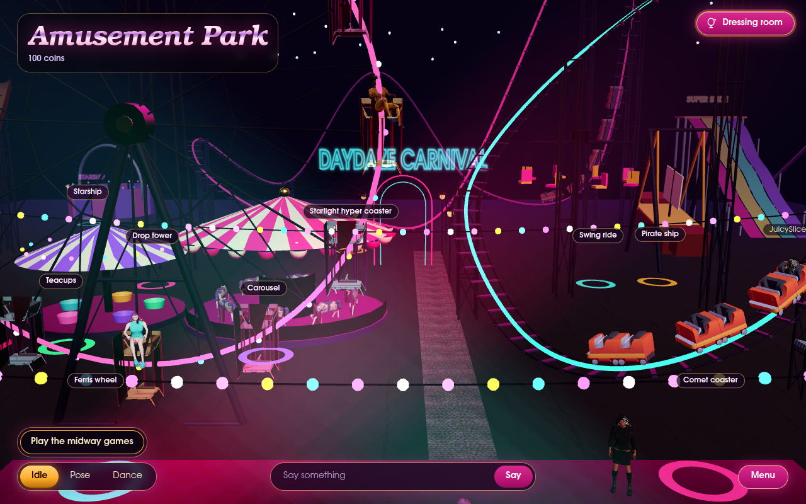
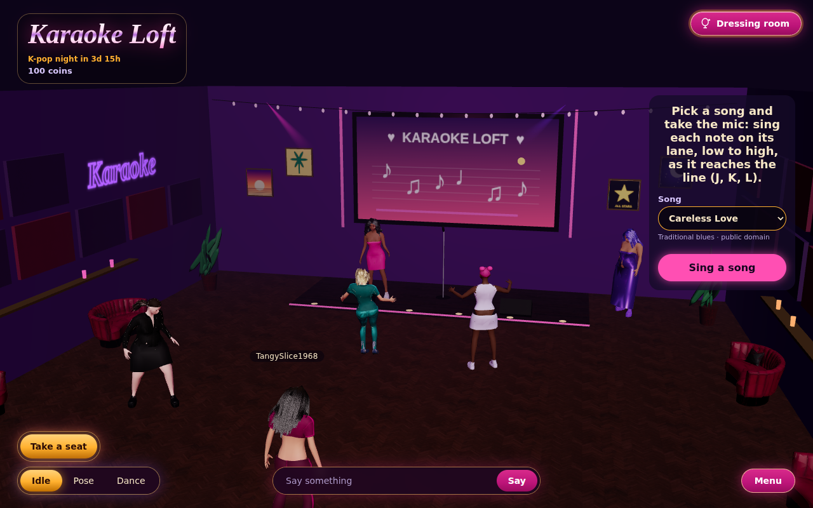
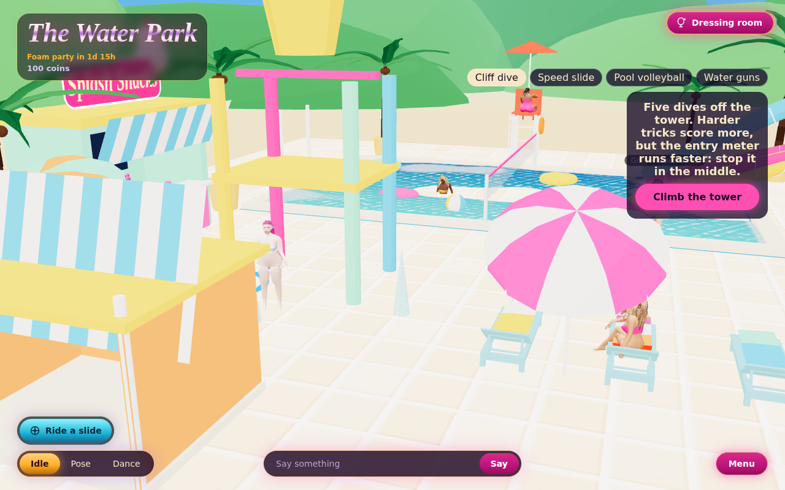
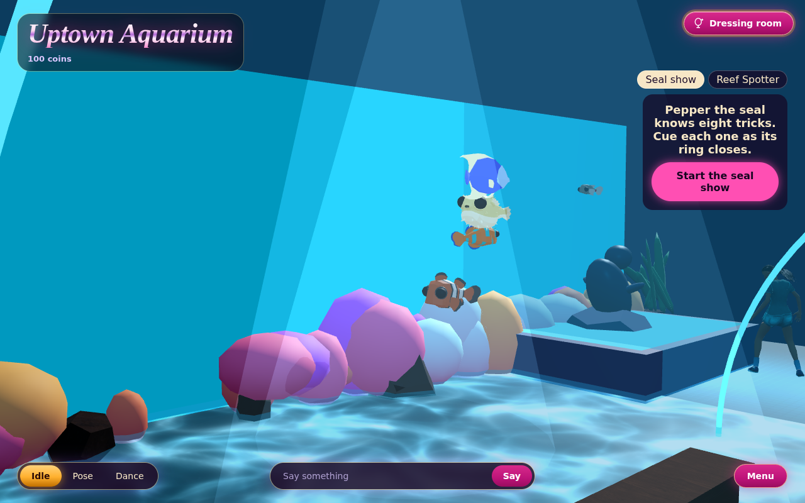
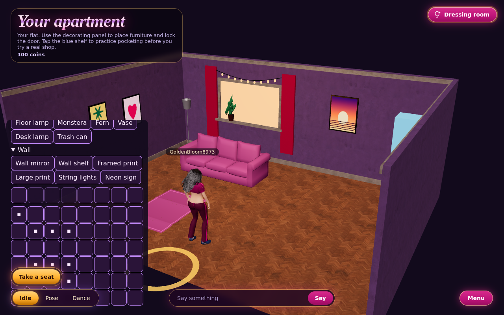
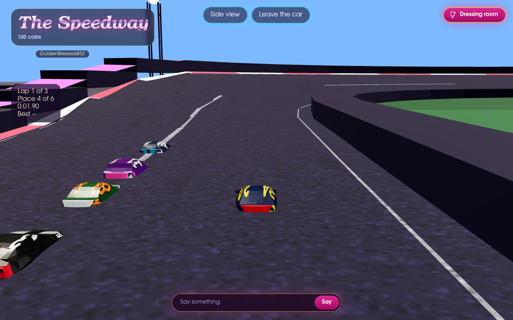
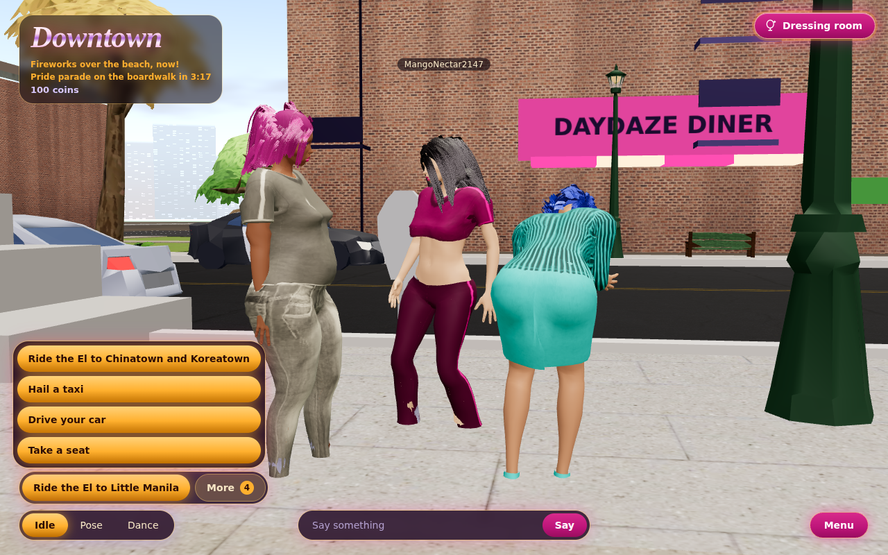
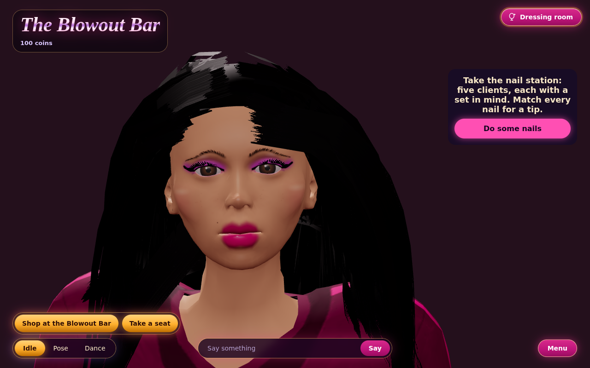

# Daydaze

[](https://github.com/dpologdvinity/daydaze/actions/workflows/ci.yml)


A multiplayer open-city game for adults: GTA-style city life meets IMVU-style
dress-up. Drive the city, get into trouble, dress up a doll avatar, hang out
in neon lounges and clubs, and play minigames with friends.

Not intended for children.

## What's in it

- **A night city** of eight neighborhoods, streamed in chunks, with traffic,
  doors into about 65 rooms, fireworks over the beach and a Pride parade on
  the boardwalk. Drive your own car (12 models, wraps, rims, underglow,
  tint, a horn, a radio and headlights), fill up at gas stations.
- **Places**: clubs and bars (Pulse, The Skylark, Sugar Rush, Bassline,
  Karaoke Loft, La Noche, Player 2, a speakeasy), restaurants, shops and the
  Starlight Galleria, a zoo, an aquarium, a water park, an amusement park,
  a speedway, sports venues, a marina, your apartment and a jail.
- **Games**, each with prizes, personal bests and daily challenges: bowling,
  tennis, mini golf, skate, surfing, Skee-Ball, curling, fishing, laser tag,
  paintball, races, counter games (ramen, sushi, boba, halo-halo, a Filipino
  cook-off), a karaoke rhythm game, cliff dives, a speed slide, beach and
  pool volleyball, a haunted house escape, the Midway and arcade cabinets.
- **A semi-realistic 3D doll** built in Blender, with a face and body closet,
  outfits, shoes, piercings, makeup, walk styles, dances and pronouns.
- **Online** (guests and accounts with cloud saves, shared rooms, chat with
  a strict filter option, friends, block, mute and report, Crazy Eights,
  couple emotes like hugs and slow dances, cook-offs) on a Cloudflare Worker
  with Durable Objects and D1. It's behind `?online=1` and not deployed yet.

All music and sound is synthesized in the browser. NPC lines are handwritten.

## Screenshots

Taken on GitHub's runners (CPU-rendered, low tier) from `main` on
2026-11-14 with `gh workflow run screenshots.yml`; every shot is listed in
`scripts/screenshots.ts`, and more live in [`docs/screenshots/`](docs/screenshots/).
The [latest screenshots of every room and door](https://github.com/dpologdvinity/daydaze/tree/screenshots/main)
are retaken on each push to `main` that changes the game.

|                                                                                                                         |                                                                                           |
| ----------------------------------------------------------------------------------------------------------------------- | ----------------------------------------------------------------------------------------- |
|                         |        |
| The city from above                                                                                                     | The boardwalk at Beachside                                                                |
|  |  |
| The Amusement Park                                                                                                      | Karaoke Loft and its rhythm game                                                          |
|                         |                  |
| The Water Park                                                                                                          | Uptown Aquarium's seal show                                                               |
|                               |          |
| Decorating your apartment                                                                                               | The Speedway                                                                              |
|                             |          |
| One action pill and a More menu                                                                                         | Zoom in for a portrait                                                                    |

Latest progress (2026-11-14): `main`'s CI is green again. The first load is
568 KB of its 600 KB budget, and `npm run verify` now enforces it. Keyboard and
portrait zoom shipped, and the dock now folds its actions into one pill. The
running log is
[`docs/plans/2026-10-23-next-steps.md`](docs/plans/2026-10-23-next-steps.md);
next up is [`docs/plans/2026-11-14-next.md`](docs/plans/2026-11-14-next.md).

## Documentation

- [ARCHITECTURE.md](ARCHITECTURE.md): how the code is laid out and fits
  together.
- [docs/VISION.md](docs/VISION.md): the product, audience and tone.
- [docs/plans/2026-10-23-next-steps.md](docs/plans/2026-10-23-next-steps.md):
  what's done and what's next.
- [docs/security.md](docs/security.md): threat model and known gaps.
- [docs/deploy.md](docs/deploy.md): deploying the Worker.
- [CONTRIBUTING.md](CONTRIBUTING.md): local workflow, checks, commit and
  pull request conventions.
- [docs/dev-tools.md](docs/dev-tools.md): the in-game dev panel (press
  `` ` `` in `npm run dev`), console handles and every URL flag.
- [CHANGELOG.md](CHANGELOG.md): what changed, newest first.
- [docs/README.md](docs/README.md): an index of everything under `docs/`.
- `docs/specs/`: design specs.
- [docs/agents/](docs/agents/README.md): how the game is built with
  parallel AI coding agents (workflow, agent brief, merge scripts, the
  owner's rules and why).

## CI

GitHub Actions, in `.github/workflows/`:

| Workflow           | When                                                        | What                                                                                                                                   |
| ------------------ | ----------------------------------------------------------- | -------------------------------------------------------------------------------------------------------------------------------------- |
| `ci.yml`           | push and pull request to `main`, `v*` tags                  | install (cached), lint, format and type checks, unit tests with coverage, the production build and perf budget; a tag drafts a release |
| `playwright.yml`   | push and pull request to `main`, by hand                    | `npm run verify`, then the client browser tests in four shards and the minigames suite                                                 |
| `verify.yml`       | push to `feat/**`, `fix/**`, `perf/**`, `ci/**`             | `npm run verify`, so branches are checked before they merge                                                                            |
| `browser-test.yml` | by hand, `-f grep="<title>"`                                | the Playwright tests whose titles match                                                                                                |
| `screenshots.yml`  | push to `main` (game files), by hand, `-f shots="<tokens>"` | screenshots in shards, as an artifact and a gallery folder on the `screenshots` branch                                                 |
| `profile.yml`      | push to `perf/smooth`, by hand                              | a performance profile                                                                                                                  |
| `codeql.yml`       | push and pull request to `main`, weekly                     | CodeQL security scanning of the TypeScript and the workflows; findings in the Security tab                                             |
| `deploy.yml`       | by hand, owner-approved                                     | the Cloudflare deploy                                                                                                                  |

## Develop

Requires Node.js 22.18 or newer (`.nvmrc` pins 26).

```bash
npm install
npm run dev               # client at http://localhost:5173
npm run lint              # ESLint (TypeScript and React hooks rules)
npm run lint:md          # markdownlint-cli2 over the Markdown docs
npm test                  # unit tests (game rules, protocol, server)
npm run test:coverage     # the same, with a coverage report in coverage/ and coverage minimums enforced
npm run typecheck         # strict TypeScript, including the Worker
npm run verify            # lint, tests, typecheck, format check, build, perf budget
npm run test:e2e:client   # Playwright browser tests (slow: software WebGL)
npm run test:e2e:online   # two browsers against a local Worker
npm run test:e2e:sw       # the service worker on a production build
npm run smoke:server      # the server end to end
```

In development, press `` ` `` for the dev panel: FPS and draw calls,
wireframe, a free camera, jumps to any room, game or event, a live clock, an
object inspector and more. See [docs/dev-tools.md](docs/dev-tools.md).

URL flags: `?quality=low|high|ultra` forces a quality tier, `?still=1` renders a
few frames and stops (for screenshots), `?debug=1` shows room jump buttons,
`?online=1` turns on online play, `?timescale=0.1` slows game time for frame
strips. The full list is in [docs/dev-tools.md](docs/dev-tools.md#url-flags).

### Online locally

```bash
npx wrangler d1 migrations apply DB --local --config server/wrangler.jsonc
npm run dev:server        # builds, then wrangler dev on port 8787
npm run dev               # in another terminal; Vite proxies /api and /ws
```

Then open `http://localhost:5173/?online=1`.

## Contributing

See [CONTRIBUTING.md](CONTRIBUTING.md). In short:

- Keep rules in `src/game` (pure, tested) and drawing in `src/client`.
- Add or update tests with every change; for a bug, write the failing test
  first. Run `npm run verify` and the browser tests for what you touched.
- Every file starts with a comment saying what it's for; exported functions
  and components have docstrings.
- Commits follow [Conventional Commits](https://www.conventionalcommits.org/),
  small and focused: `feat(net): add room copy directory`.
- Validate anything from the network or `localStorage` before use. Keep the
  18+ venues behind the age gate.

## License

Copyright (c) 2026 Kaitlyn Bassford. All rights reserved. The source is public
to read, not to reuse; see [LICENSE](LICENSE). Third-party assets keep their own
licenses ([docs/assets.md](docs/assets.md)).
